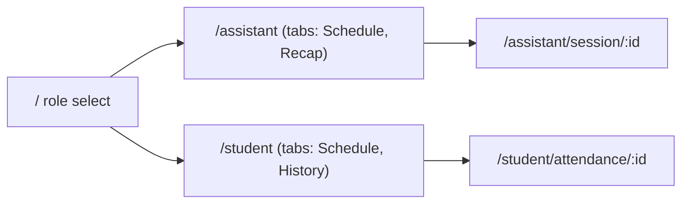
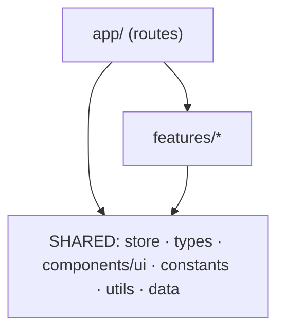
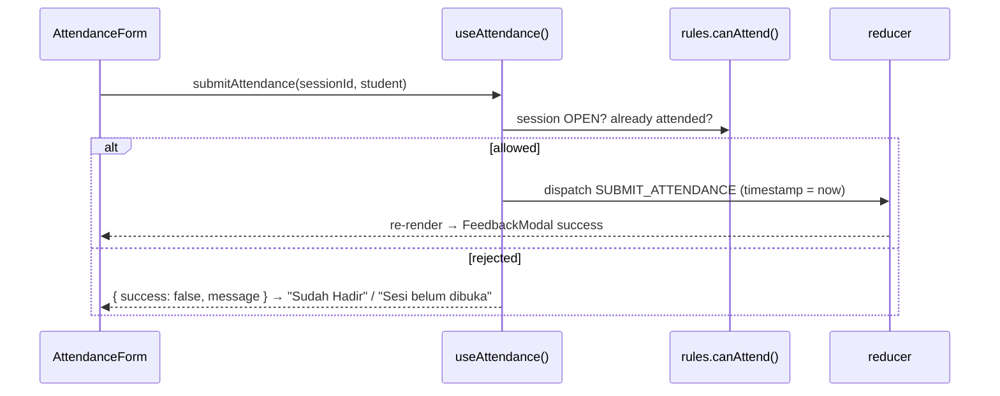

# Architecture

> Single source of truth for project structure and code rules. `README.md` and `AGENTS.md` only point here.
> If you want to change the structure, update this file in the same PR.

**Stack:** Expo SDK 57 · Expo Router · React Native 0.86 · TypeScript (strict)
**Approach:** pragmatic feature-based (Bulletproof React) + thin routes (Expo Router). Not full Clean Architecture; see [§8 Why](#8-why-this-structure).

---

## 1. Folder structure

```
src/
├── app/                                  # ROUTES + composition only (Expo Router)
│   ├── _layout.tsx                       #   root <Stack> wrapped in <AppProvider>
│   ├── index.tsx                         #   /                        role & identity select
│   ├── assistant/
│   │   ├── (tabs)/_layout.tsx            #   tabs: Schedule | Recap
│   │   ├── (tabs)/index.tsx              #   /assistant               schedule list
│   │   ├── (tabs)/recap.tsx              #   /assistant/recap         overall recap
│   │   └── session/[id].tsx              #   /assistant/session/:id   detail + open/close + recap
│   └── student/
│       ├── (tabs)/_layout.tsx            #   tabs: Schedule | History
│       ├── (tabs)/index.tsx              #   /student                 schedule list
│       ├── (tabs)/history.tsx            #   /student/history         own attendance history
│       └── attendance/[id].tsx           #   /student/attendance/:id  detail + attendance form
│
├── features/                             # FEATURE components, grouped by domain
│   ├── role/components/                  #   RoleSelectorModal
│   ├── sessions/components/              #   SessionCard, StatusBadge, SessionControlModal
│   └── attendance/components/            #   AttendanceForm, AttendanceSuccessCard,
│                                         #   AttendanceTable, StatSummaryCard, HistoryItemCard
│
├── store/                                # GLOBAL STATE (shared)
│   ├── AppProvider.tsx                   #   Context + useReducer
│   ├── reducer.ts                        #   state transitions
│   ├── rules.ts                          #   pure business rules: canOpen, canClose, canAttend
│   └── hooks.ts                          #   useCurrentUser, useSessions, useAttendance
├── data/mockData.ts                      # dummy data (later: services/ for the database)
├── types/attendance.ts                   # UserProfile, PracticalSession, AttendanceRecord, ...
├── components/ui/                        # CustomButton, Card, EmptyState, FeedbackModal
├── constants/theme.ts                    # Colors, Spacing, Radius
└── utils/                                # pure helpers, e.g. formatTime.ts
```

Folders are created by their owner when adding the first file. Do not commit empty folders.

### Navigation



Detail screens live **outside** `(tabs)` and are pushed by the root `<Stack>`. This follows the Expo Router docs ("Common navigation patterns"), so the back button returns to the screen you came from. `(tabs)` is a route group and does not appear in the URL.

---

## 2. Dependency direction



Imports flow **one way**: `shared → features → app`. Never the reverse, and never sideways between features.

Rules 2 and 3 are **enforced by ESLint** (`import/no-restricted-paths` in `eslint.config.js`). `npx expo lint` fails if a feature imports another feature, or if shared code imports from `features/` or `app/`. When you add a new feature folder, add its name to the `features` list in `eslint.config.js`.

---

## 3. Rules

| # | Rule | Example |
|---|---|---|
| 1 | `app/` files only read params, call store hooks, and compose components. No business logic, no big style blocks. | `assistant/session/[id].tsx` renders `SessionControlModal` + `AttendanceTable` |
| 2 | Features **must not import each other**. Combine them in the route file. | ❌ `features/attendance` imports from `features/sessions` |
| 3 | Shared folders (`store`, `types`, `components/ui`, `constants`, `utils`, `data`) **must not import** from `features/` or `app/`. | ❌ `components/ui/Card.tsx` imports `SessionCard` |
| 4 | Never call `useContext` directly. Use the hooks from `@/store/hooks`. | ✅ `const { sessions } = useSessions()` |
| 5 | Business rules are **pure functions** in `store/rules.ts`, with no React. The UI asks the rule and does not re-implement it. | `canAttend(session, records, studentId)` |
| 6 | Use the `@/` alias with direct file imports. No `../../`, no barrel `index.ts`. | `import { Card } from '@/components/ui/Card'` |
| 7 | Create a subfolder only when it has a file. Move code to shared only when **≥2 features** use it. | |
| 8 | Use UI primitives from `components/ui/` and tokens from `constants/theme.ts` (see [DESIGN.md](DESIGN.md)). No hardcoded hex literals outside `theme.ts`. | ✅ `Colors.primary` |

### Naming

| Kind | Convention | Example |
|---|---|---|
| Components | `PascalCase.tsx`, named export | `SessionCard.tsx` → `export function SessionCard` |
| Hooks | `useCamelCase` | `useSessions` |
| Other files | `camelCase.ts` | `rules.ts`, `formatTime.ts` |
| Route files | lowercase, English | `history.tsx`, `[id].tsx` |
| Code identifiers & enum values | English | `'NOT_STARTED' \| 'OPEN' \| 'CLOSED'` |
| Text shown to users | Bahasa Indonesia | `"Sudah Hadir"`, `"Sesi belum dibuka"` |

---

## 4. Data contract (owner: Zaidan)

```ts
// src/types/attendance.ts
export type SessionStatus = 'NOT_STARTED' | 'OPEN' | 'CLOSED';
export type UserRole = 'ASSISTANT' | 'STUDENT';

export interface UserProfile {
  id: string;
  name: string;
  role: UserRole;
  identifier: string; // NIM or assistant code
}

export interface PracticalSession {
  id: string;
  courseName: string;
  classCode: string;
  room: string;
  timeSlot: string;
  date: string;
  status: SessionStatus;
  assistantId: string;
  assistantName: string;
  totalStudents: number;
}

export interface AttendanceRecord {
  id: string;
  sessionId: string;
  studentId: string;
  studentName: string;
  studentNim: string;
  timestamp: string; // ISO string, format for display with utils/formatTime
  notes?: string;
}
```

### Store hooks (`src/store/hooks.ts`)

| Hook | Returns | Used by |
|---|---|---|
| `useCurrentUser()` | `currentUser`, `setCurrentUser` | role select, every screen that needs the active user |
| `useSessions()` | `sessions`, `getSessionById`, `openSession`, `closeSession` | schedule lists, session detail |
| `useAttendance()` | `attendanceRecords`, `submitAttendance`, `isAlreadyAttended`, `getAttendanceBySession`, `getAttendanceByStudent` | attendance form, recap, history |

Method signatures are listed in `docs/TUGAS_ZAIDAN.md` §3.3.

---

## 5. Data flow example: student submits attendance



---

## 6. Ownership

| Member | Files |
|---|---|
| **Zaidan** | `types/attendance.ts`, `data/mockData.ts`, `store/*`, `features/role/*`, `features/sessions/components/{StatusBadge,SessionControlModal}`, `features/attendance/components/{AttendanceTable,StatSummaryCard}`, `app/_layout.tsx`, `app/index.tsx`, `app/assistant/**` |
| **Bayu** | `components/ui/*`, `constants/theme.ts`, `utils/*`, `features/sessions/components/SessionCard`, `app/student/(tabs)/_layout.tsx`, `app/student/(tabs)/index.tsx` |
| **Bahir** | `features/attendance/components/{AttendanceForm,AttendanceSuccessCard,HistoryItemCard}`, `app/student/attendance/[id].tsx`, `app/student/(tabs)/history.tsx` |

**Merge order:** Zaidan (`types`, `store`) and Bayu (`components/ui`, `theme`) first, then feature PRs.

**Branches:** base branch is `dev`. Name branches `feat/<name>/<feature>` or `chore/<name>/<task>`. Run `npx tsc --noEmit` and `npx expo lint` before opening a PR.

---

## 7. Moving to a database (later sprints)

| Layer | Sprint 1 | With database | UI changes? |
|---|---|---|---|
| `data/` | `mockData.ts` | `services/` (API / Supabase / Firebase client) | no |
| `store/` | in-memory reducer | calls services, adds `loading` / `error` | no |
| `store/rules.ts` | pure rules | unchanged (server validates too) | no |
| feature components | – | show loading / error states | minimal |

Rules 4 and 5 make this possible. Components only talk to store hooks, so swapping the data source does not touch them.

---

## 8. Why this structure

| Option | Decision | Reason |
|---|---|---|
| Type-based only (`screens/`, `components/`) | rejected | 3 people editing the same folders; feature code gets mixed |
| **Feature-based (Bulletproof React)** | **chosen** | recommended for teams; matches the per-domain task split |
| Full Clean Architecture (use cases, repositories) | rejected | heavy boilerplate for ~8 screens; we keep only "rules are pure functions" |
| Feature-Sliced Design (6 layers) | rejected | too many layers; we keep only "imports go one way" |
| Barrel `index.ts` files | rejected | Bulletproof React no longer recommends them |
| Context + `useReducer` | chosen | state only changes on button presses; no new dependency |
| Zustand / Redux | not now | revisit only if re-render performance becomes a real problem |

### Sources
- Expo Router: core concepts, notation, common navigation patterns, `src` directory. https://docs.expo.dev/router/introduction/
- Bulletproof React, project structure. https://github.com/alan2207/bulletproof-react/blob/master/docs/project-structure.md
- Feature-Sliced Design. https://feature-sliced.design/
- React: scaling up with reducer and context. https://react.dev/learn/scaling-up-with-reducer-and-context
- Medium: hanifmhd, *React Native Structure Folder for Simplicity* (part 1 & 2); Sarmila Sivaraja, *Choosing the Right Project Structure for Your React Native App*; Silversky Technology, *React Native Project Structure for Scalable Applications*
- Reference repo: `petelpop/findme-frontend` (features + shared)

