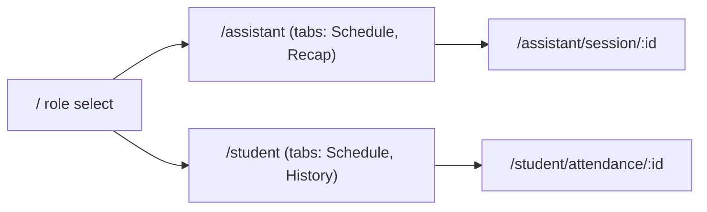
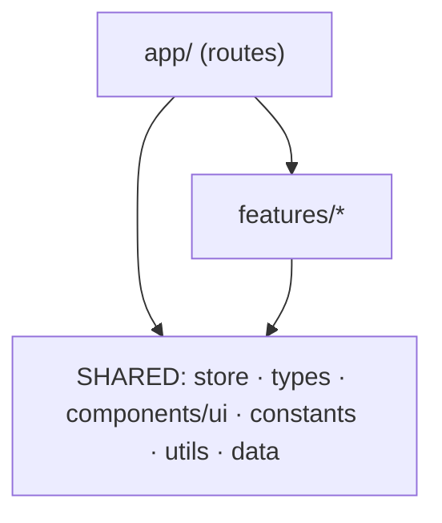
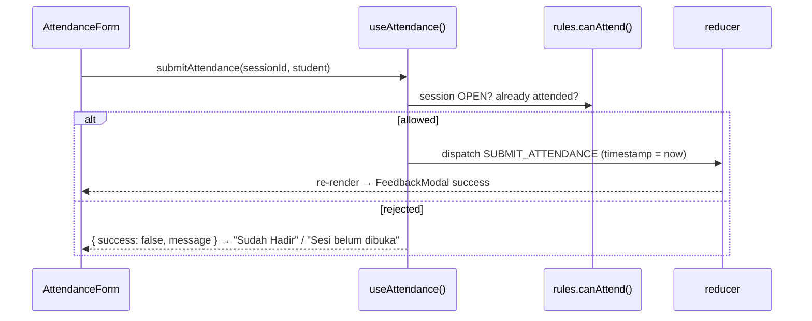
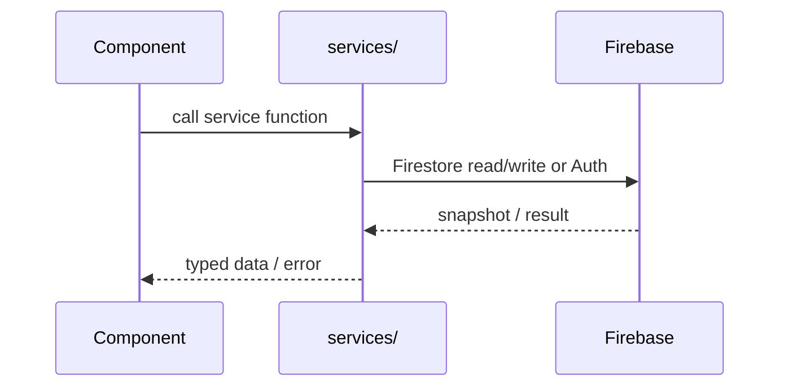
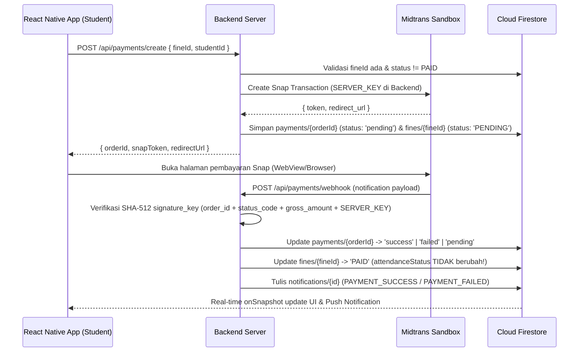

# Architecture

> Single source of truth for project structure and code rules. `README.md` and `AGENTS.md` only point here.
> If you want to change the structure, update this file in the same PR.

**Stack:** Expo SDK 58 · Expo Router · React Native 0.88 · TypeScript (strict)
**Approach:** pragmatic feature-based (Bulletproof React) + thin routes (Expo Router). Not full Clean Architecture; see [§8 Why](#8-why-this-structure).

---

## 1. Folder structure

```
src/
├── app/                                  # ROUTES + composition only (Expo Router)
│   ├── _layout.tsx                       #   root <Stack> wrapped in <AppProvider>
│   ├── index.tsx                         #   /                        role & identity select
│   ├── assistant/
│   │   ├── (tabs)/_layout.tsx            #   tabs: Schedule | Recap
│   │   ├── (tabs)/index.tsx              #   /assistant               schedule list
│   │   ├── (tabs)/recap.tsx              #   /assistant/recap         overall recap
│   │   └── session/[id].tsx              #   /assistant/session/:id   detail + open/close + recap
│   └── student/
│       ├── (tabs)/_layout.tsx            #   tabs: Schedule | History
│       ├── (tabs)/index.tsx              #   /student                 schedule list
│       ├── (tabs)/history.tsx            #   /student/history         own attendance history
│       └── attendance/[id].tsx           #   /student/attendance/:id  detail + attendance form
│
├── features/                             # FEATURE components, grouped by domain
│   ├── role/components/                  #   RoleSelectorModal
│   ├── sessions/components/              #   SessionCard, StatusBadge, SessionControlModal
│   └── attendance/components/            #   AttendanceForm, AttendanceSuccessCard,
│                                         #   AttendanceTable, StatSummaryCard, HistoryItemCard
│
├── store/                                # GLOBAL STATE (shared)
│   ├── AppProvider.tsx                   #   Context + useReducer
│   ├── reducer.ts                        #   state transitions
│   ├── rules.ts                          #   pure business rules: canOpen, canClose, canAttend
│   └── hooks.ts                          #   useCurrentUser, useSessions, useAttendance
├── data/mockData.ts                      # dummy data (later: services/ for the database)
├── types/attendance.ts                   # UserProfile, PracticalSession, AttendanceRecord, ...
├── components/ui/                        # CustomButton, Card, EmptyState, FeedbackModal
├── constants/theme.ts                    # Colors, Spacing, Radius
└── utils/                                # pure helpers, e.g. formatTime.ts
```

Folders are created by their owner when adding the first file. Do not commit empty folders.

### Navigation



Detail screens live **outside** `(tabs)` and are pushed by the root `<Stack>`. This follows the Expo Router docs ("Common navigation patterns"), so the back button returns to the screen you came from. `(tabs)` is a route group and does not appear in the URL.

---

## 2. Dependency direction



Imports flow **one way**: `shared → features → app`. Never the reverse, and never sideways between features.

Rules 2 and 3 are **enforced by ESLint** (`import/no-restricted-paths` in `eslint.config.js`). `npx expo lint` fails if a feature imports another feature, or if shared code imports from `features/` or `app/`. When you add a new feature folder, add its name to the `features` list in `eslint.config.js`.

---

## 3. Rules

| # | Rule | Example |
|---|---|---|
| 1 | `app/` files only read params, call store hooks, and compose components. No business logic, no big style blocks. | `assistant/session/[id].tsx` renders `SessionControlModal` + `AttendanceTable` |
| 2 | Features **must not import each other**. Combine them in the route file. | ❌ `features/attendance` imports from `features/sessions` |
| 3 | Shared folders (`store`, `types`, `components/ui`, `constants`, `utils`, `data`) **must not import** from `features/` or `app/`. | ❌ `components/ui/Card.tsx` imports `SessionCard` |
| 4 | Never call `useContext` directly. Use the hooks from `@/store/hooks`. | ✅ `const { sessions } = useSessions()` |
| 5 | Business rules are **pure functions** in `store/rules.ts`, with no React. The UI asks the rule and does not re-implement it. | `canAttend(session, records, studentId)` |
| 6 | Use the `@/` alias with direct file imports. No `../../`, no barrel `index.ts`. | `import { Card } from '@/components/ui/Card'` |
| 7 | Create a subfolder only when it has a file. Move code to shared only when **≥2 features** use it. | |
| 8 | Use UI primitives from `components/ui/` and tokens from `constants/theme.ts` (see [DESIGN.md](DESIGN.md)). No hardcoded hex literals outside `theme.ts`. | ✅ `Colors.primary` |

### Naming

| Kind | Convention | Example |
|---|---|---|
| Components | `PascalCase.tsx`, named export | `SessionCard.tsx` → `export function SessionCard` |
| Hooks | `useCamelCase` | `useSessions` |
| Other files | `camelCase.ts` | `rules.ts`, `formatTime.ts` |
| Route files | lowercase, English | `history.tsx`, `[id].tsx` |
| Code identifiers & enum values | English | `'NOT_STARTED' \| 'OPEN' \| 'CLOSED'` |
| Text shown to users | Bahasa Indonesia | `"Sudah Hadir"`, `"Sesi belum dibuka"` |

---

## 4. Data contract (owner: Zaidan)

```ts
// src/types/attendance.ts
export type SessionStatus = 'NOT_STARTED' | 'OPEN' | 'CLOSED';
export type UserRole = 'ASSISTANT' | 'STUDENT';

export interface UserProfile {
  id: string;
  name: string;
  role: UserRole;
  identifier: string; // NIM or assistant code
}

export interface PracticalSession {
  id: string;
  courseName: string;
  classCode: string;
  room: string;
  timeSlot: string;
  date: string;
  status: SessionStatus;
  assistantId: string;
  assistantName: string;
  totalStudents: number;
}

export interface AttendanceRecord {
  id: string;
  sessionId: string;
  studentId: string;
  studentName: string;
  studentNim: string;
  timestamp: string; // ISO string, format for display with utils/formatTime
  notes?: string;
}
```

### Store hooks (`src/store/hooks.ts`)

| Hook | Returns | Used by |
|---|---|---|
| `useCurrentUser()` | `currentUser`, `setCurrentUser` | role select, every screen that needs the active user |
| `useSessions()` | `sessions`, `getSessionById`, `openSession`, `closeSession` | schedule lists, session detail |
| `useAttendance()` | `attendanceRecords`, `submitAttendance`, `isAlreadyAttended`, `getAttendanceBySession`, `getAttendanceByStudent` | attendance form, recap, history |

Method signatures are listed in `docs/TUGAS_ZAIDAN.md` §3.3.

---

## 5. Data flow example: student submits attendance



---

## 6. Ownership

| Member | Files |
|---|---|
| **Zaidan** | `types/attendance.ts`, `data/mockData.ts`, `store/*`, `features/role/*`, `features/sessions/components/{StatusBadge,SessionControlModal}`, `features/attendance/components/{AttendanceTable,StatSummaryCard}`, `app/_layout.tsx`, `app/index.tsx`, `app/assistant/**` |
| **Bayu** | `components/ui/*`, `constants/theme.ts`, `utils/*`, `features/sessions/components/SessionCard`, `app/student/(tabs)/_layout.tsx`, `app/student/(tabs)/index.tsx` |
| **Bahir** | `features/attendance/components/{AttendanceForm,AttendanceSuccessCard,HistoryItemCard}`, `app/student/attendance/[id].tsx`, `app/student/(tabs)/history.tsx` |

**Merge order:** Zaidan (`types`, `store`) and Bayu (`components/ui`, `theme`) first, then feature PRs.

**Branches:** base branch is `dev`. Name branches `feat/<name>/<feature>` or `chore/<name>/<task>`. Run `npx tsc --noEmit` and `npx expo lint` before opening a PR.

---

## 7. Sprint 2 — Firebase Integration

> Sprint 1 code is **complete and must not be edited**. Sprint 2 adds new files alongside existing ones.

### New folders (Sprint 2 only)

```
src/
├── services/                         # Firebase & AI client calls — owned by Sprint 2 members
│   ├── firebase.ts                   # Firebase app init (Bayu)
│   ├── auth.ts                       # signIn, signUp, signOut, onAuthChange (Bayu)
│   ├── sessions.ts                   # Firestore CRUD for sessions (Bayu)
│   ├── attendance.ts                 # Firestore write/query for attendance (Bahir)
│   ├── permits.ts                    # Firestore CRUD for permit requests (Ferdy)
│   └── ai.ts                         # AI Model client according to repo guide (Ferdy)
├── types/
│   └── permit.ts                     # PermitRequest, PermitStatus, AIClassification (Ferdy)
└── features/
    └── permits/components/           # PermitForm, PermitStatusCard, PermitReviewCard (Ferdy)
```

### New routes (Sprint 2 only)

| Route | Purpose | Owner |
|---|---|---|
| `app/assistant/(tabs)/permits.tsx` | Daftar izin praktikan + Review asisten | Ferdy |
| `app/student/(tabs)/permit.tsx` | Form pengajuan izin + Status | Ferdy |

### Data flow Sprint 2



`store/` hooks from Sprint 1 remain untouched. Sprint 2 screens call `services/` directly or via new hooks added to `hooks.ts` only if needed.

### Ownership Sprint 2

| Member | Files |
|---|---|
| **Bayu** | `services/firebase.ts`, `services/auth.ts`, `services/sessions.ts`, `app/index.tsx` (login screen), `app/assistant/(tabs)/_layout.tsx` (auth guard), `app/student/(tabs)/_layout.tsx` (auth guard) |
| **Bahir** | `services/attendance.ts`, `app/assistant/session/[id].tsx` (real-time listener), `app/assistant/(tabs)/recap.tsx` (real-time), Firebase Security Rules config |
| **Ferdy** | `services/permits.ts`, `types/permit.ts`, `features/permits/components/*`, `app/assistant/(tabs)/permits.tsx`, `app/student/(tabs)/permit.tsx` |

---

## 8. Sprint 3 — Geolocation, Maps & Push Notifications (Zaidan & Ferdy)

> Sprint 1 & Sprint 2 base code remains stable. Sprint 3 adds geolocation validation, interactive laboratory maps, targeted push notifications, and device permission handling divided strictly between **Zaidan** and **Ferdy**.

### New files & folders (Sprint 3)

```
src/
├── types/
│   ├── lab.ts                        # LabLocation, Coordinates, LocationValidationResult (Zaidan)
│   └── notification.ts               # AppNotification, NotificationEventType, DevicePermissionState (Ferdy)
├── utils/
│   └── geo.ts                        # Pure Haversine distance & isWithinRadius helpers (Zaidan)
├── services/
│   ├── labs.ts                       # Firestore CRUD for lab locations & radius (Zaidan)
│   ├── permissions.ts                # Location & notification runtime permissions + edge-case checks (Ferdy)
│   └── notifications.ts              # Push notifications (FCM/Expo Notifications) + Firestore targeted log (Ferdy)
└── features/
    ├── attendance/components/
    │   ├── LocationStatusBanner.tsx  # Real-time distance & radius status badge (Zaidan)
    │   └── LabLocationConfigModal.tsx# Assistant modal to configure lab coordinates & radius (Zaidan)
    └── maps/components/              # Add 'maps' to features array in eslint.config.js (Ferdy)
        ├── InteractiveLabMap.tsx     # MapView + lab markers + radius Circle + live user marker
        ├── LabActivitySheet.tsx      # Ongoing & upcoming sessions at selected lab (Firestore)
        └── PermissionAlertCard.tsx   # Graceful UI alert for denied permissions / disabled GPS
```

### New routes (Sprint 3)

| Route | Purpose | Owner |
|---|---|---|
| `app/student/check-in/[id].tsx` | Dedicated check-in screen separated from session detail (`attendance/[id].tsx`), validates GPS radius + optional QR | Zaidan |
| `app/student/(tabs)/maps.tsx` | Interactive laboratory map + live user position + ongoing/upcoming sessions | Ferdy |
| `app/assistant/(tabs)/maps.tsx` | Interactive laboratory map + activity overview for assistants | Ferdy |

### Expo SDK 58 Native Config Rule (CNG)

Because this repository uses **Expo Continuous Native Generation (CNG)** (no committed `ios/` or `android/` directories):
- Install native modules strictly via `npx expo install expo-location react-native-maps expo-notifications` (and optional `expo-camera`).
- Configure Google Maps API key, location permission strings, and notification plugin strictly in `app.json` — **never** create or hand-edit `android/` or `ios/` folders.
- Provide a clean web fallback for `react-native-maps` (`Platform.OS === 'web'`) so web preview never crashes.
- When creating `src/features/maps/`, add `'maps'` to `const features = ['role', 'sessions', 'attendance', 'permits', 'maps']` in `eslint.config.js`.

### Ownership Sprint 3 (Zaidan & Ferdy)

| Member | Files |
|---|---|
| **Zaidan** | `types/lab.ts`, `utils/geo.ts`, `services/labs.ts`, `services/attendance.ts` (enforce radius check inside `submitAttendanceToFirestore`), `features/attendance/components/{LocationStatusBanner,LabLocationConfigModal}.tsx`, `app/student/check-in/[id].tsx`, `app/student/attendance/[id].tsx` (session detail -> navigate to check-in), `app/assistant/session/[id].tsx` (configure lab location & radius) |
| **Ferdy** | `types/notification.ts`, `services/permissions.ts`, `services/notifications.ts`, `features/maps/components/{InteractiveLabMap,LabActivitySheet,PermissionAlertCard}.tsx`, `app/student/(tabs)/maps.tsx`, `app/assistant/(tabs)/maps.tsx`, `app/student/(tabs)/_layout.tsx` & `app/assistant/(tabs)/_layout.tsx` (add `maps` tab), `eslint.config.js` (register `'maps'` feature), `app/_layout.tsx` (foreground notification & deep link listener) |

---

## 9. Sprint 4 (Pertemuan 9) — Manajemen Lab (Aslab), Keterlambatan/Denda, & Midtrans Payment Gateway

> Sprint 1, 2, dan 3 sudah selesai dan stabil. Sprint 4 menambahkan peran baru **Aslab (`ASLAB`)**, pemisahan wewenang **Asprak (`ASSISTANT`)**, sistem **keterlambatan (*grace period*) & denda**, serta **integrasi Payment Gateway Midtrans (Sandbox)** dengan arsitektur *client–server–webhook*.

### 9.1 New files & folders (Sprint 4)

```text
Praktikum_PPK_06/
├── backend/                                        # Backend Payment Server (Ferdy) — Node.js / Express atau Firebase Functions
│   ├── src/
│   │   ├── index.ts                                # Express app / HTTP endpoints
│   │   ├── midtrans.ts                             # Midtrans Snap client (MIDTRANS_SERVER_KEY hanya di sini!)
│   │   └── webhook.ts                              # Verifikasi SHA-512 signature key & update Firestore (payments + fines)
│   ├── .env.example                                # MIDTRANS_SERVER_KEY, MIDTRANS_CLIENT_KEY, FIREBASE_SERVICE_ACCOUNT
│   └── package.json
└── src/
    ├── types/
    │   ├── attendance.ts                           # [UPDATE] UserRole tambah 'ASLAB'; AttendanceStatus: 'ON_TIME' | 'LATE' | 'EXCUSED_ABSENCE'
    │   ├── lab.ts                                  # [UPDATE] courseName, gracePeriodMinutes, fineAmount, assignedStudentIds, assignedAssistantIds
    │   ├── notification.ts                         # [UPDATE] tambah 'FINE_CREATED' | 'PAYMENT_SUCCESS' | 'PAYMENT_FAILED'
    │   └── fine.ts                                 # [BARU] FineRecord, FineStatus, PaymentTransaction, PaymentStatus (Bayu & Ferdy)
    ├── utils/
    │   ├── bulkTemplate.ts                         # [BARU] Generator template CSV + parser row untuk 3 jenis bulk insert terpisah (Zaidan)
    │   └── lateness.ts                             # [BARU] Pure function evaluateLateness(checkInIso, sessionStartIso, gracePeriodMinutes) (Bayu)
    ├── services/
    │   ├── labs.ts                                 # [UPDATE] Bulk/single insert terpisah, transfer anggota (praktikan/aslab), dashboard agregasi (Zaidan)
    │   ├── fines.ts                                # [BARU] Generator 1 tagihan denda idempotent (`fine_${sessionId}_${studentId}`) & exempt izin (Bayu)
    │   ├── payments.ts                             # [BARU] Client call ke backend (`createPaymentTransaction`), subscribe riwayat pembayaran Firestore (Ferdy)
    │   └── notifications.ts                        # [UPDATE] Channel & dispatcher notifikasi denda/pembayaran (Ferdy)
    └── features/
        ├── labs/components/                        # [BARU] Daftarkan 'labs' di eslint.config.js (Zaidan)
        │   ├── LabDashboardStats.tsx               # Ringkasan jumlah lab/praktikan, status tiap lab, riwayat keuangan denda
        │   ├── LabPeriodFilter.tsx                 # Filter dashboard: Hari | Minggu | Bulan
        │   ├── BulkInsertStagingList.tsx           # ScrollView interaktif per baris (accept/deny, edit, isi field kosong)
        │   ├── LabConfigModal.tsx                  # Konfigurasi nama, lokasi, koordinat, radius presensi, grace period & denda
        │   └── MemberTransferCard.tsx              # Pindah praktikan antar lab & pindah aslab/asprak (tanpa pindah jadwal)
        └── fines/components/                       # [BARU] Daftarkan 'fines' di eslint.config.js (Bayu & Ferdy)
            ├── LatenessBadge.tsx                   # Badge status: Tepat Waktu / Terlambat (+X mnt) / Izin (Bayu)
            ├── FineCard.tsx                        # Kartu rincian tagihan denda & tombol Bayar (Ferdy)
            ├── PaymentStatusBadge.tsx              # Badge status pembayaran: pending / success / failed (Ferdy)
            └── PaymentHistoryItem.tsx              # Item riwayat pembayaran persisten (Ferdy)
```

### 9.2 New routes (Sprint 4)

| Route | Purpose | Owner |
|---|---|---|
| `app/aslab/(tabs)/_layout.tsx` | Tab shell & RBAC guard khusus `ASLAB` (Dashboard \| Kelola Lab \| Bulk Insert \| Pindah Anggota) | Zaidan |
| `app/aslab/(tabs)/index.tsx` | Dashboard keberlangsungan lab (filter hari/minggu/bulan + riwayat kegiatan & keuangan denda) | Zaidan |
| `app/aslab/(tabs)/labs.tsx` | Manajemen daftar lab (single insert, edit lokasi/koordinat/radius/grace period/denda) | Zaidan |
| `app/aslab/(tabs)/bulk.tsx` | 3 tab/opsi bulk insert terpisah (Lab per MK, Praktikan ke Lab, Asprak ke Lab) + download template + ScrollView staging | Zaidan |
| `app/aslab/(tabs)/transfer.tsx` | Perpindahan praktikan antar lab & perpindahan aslab/asprak (tanpa perpindahan jadwal) | Zaidan |
| `app/student/(tabs)/fines.tsx` | Daftar tagihan denda aktif & halaman riwayat pembayaran persisten praktikan | Ferdy |
| `app/student/payment/[fineId].tsx` | Halaman checkout Midtrans Sandbox (Snap WebView/Browser) & polling/listener status pembayaran | Ferdy |

### 9.3 RBAC Matrix (Sprint 4)

| Hak Akses / Fitur | `ASLAB` (Baru) | `ASSISTANT` (Asprak) | `STUDENT` (Praktikan) | `ADMIN` |
|---|:---:|:---:|:---:|:---:|
| Kelola Lab (CRUD, Koordinat, Radius, Grace Period, Denda) | ✅ | ❌ | ❌ | ✅ |
| 3 Bulk/Single Insert (Lab, Praktikan, Asprak) + Template | ✅ | ❌ | ❌ | ✅ |
| Pindah Praktikan antar Lab & Pindah Aslab/Asprak | ✅ | ❌ | ❌ | ✅ |
| Dashboard Keberlangsungan Lab & Keuangan Denda | ✅ | ❌ | ❌ | ✅ |
| Lihat Kelas/Jadwal/Sesi Tanggung Jawab & Buka/Tutup Sesi | ❌ (Pantau saja) | ✅ | ❌ (Lihat saja) | ✅ |
| Pantau/Kelola Presensi & Setujui Izin (`EXCUSED_ABSENCE`) | ❌ (Pantau saja) | ✅ | ❌ | ✅ |
| Presensi Geofencing, Ajukan Izin, Bayar Denda & Riwayat Bayar | ❌ | ❌ | ✅ | ❌ |

### 9.4 Data Contract Sprint 4 (`src/types/fine.ts` & ekstensi)

```ts
// src/types/attendance.ts (tambahan Sprint 4)
export type UserRole = 'ADMIN' | 'ASLAB' | 'ASSISTANT' | 'STUDENT';
export type AttendancePunctuality = 'ON_TIME' | 'LATE' | 'EXCUSED_ABSENCE';

// Field tambahan di AttendanceRecord:
// attendanceStatus?: AttendancePunctuality;
// lateMinutes?: number;
// fineId?: string | null;

// src/types/lab.ts (tambahan Sprint 4 di LabLocation)
// courseName?: string;
// gracePeriodMinutes: number;   // default misal 15 menit (dikonfigurasi Aslab)
// fineAmount: number;           // nominal denda tetap per keterlambatan, misal 10000 (IDR)
// assignedStudentIds?: string[];
// assignedAssistantIds?: string[];

// src/types/fine.ts (BARU Sprint 4)
export type FineStatus = 'UNPAID' | 'PENDING' | 'PAID' | 'WAIVED';
export type PaymentStatus = 'pending' | 'success' | 'failed';

export interface FineRecord {
  id: string;                    // Deterministik: `fine_${sessionId}_${studentId}` (1 tagihan per kejadian)
  studentId: string;
  studentName: string;
  studentNim: string;
  sessionId: string;
  sessionName: string;
  classCode: string;
  labId?: string;
  attendanceId: string;
  lateMinutes: number;
  amount: number;                // Nominal tetap (IDR)
  status: FineStatus;
  createdAt: string;             // ISO string
  paidAt?: string;
  latestPaymentId?: string;
}

export interface PaymentTransaction {
  id: string;                    // order_id Midtrans, misal: `PAY-${fineId}-${timestamp}`
  fineId: string;
  studentId: string;
  sessionId: string;
  sessionName: string;
  amount: number;
  status: PaymentStatus;         // 'pending' | 'success' | 'failed' (HANYA diverifikasi backend webhook)
  paymentType?: string;          // e.g. 'gopay', 'bank_transfer', 'qris'
  snapToken?: string;
  snapRedirectUrl?: string;
  midtransTransactionId?: string;
  createdAt: string;
  updatedAt: string;
}
```

### 9.5 Payment Gateway Security Flow (Client–Server–Webhook)



### 9.6 ESLint & Native Rules (Sprint 4)
- Daftarkan `'labs'` dan `'fines'` pada `const features` di `eslint.config.js`.
- `features/labs` dan `features/fines` **tidak boleh saling mengimpor** (gabungkan hanya di route file `src/app/`).
- Pasang paket tambahan wajib melalui `npx expo install` (mis. `expo-document-picker`, `expo-file-system`, `expo-sharing`, `react-native-webview`).
- **Dilarang** menyimpan `MIDTRANS_SERVER_KEY` di `src/` atau variabel `EXPO_PUBLIC_*`.

### 9.7 Ownership Sprint 4 (Zero Merge Conflict)

| Member | Files |
|---|---|
| **Zaidan** (`SRS-S4-01`, `SRS-S4-02`) | `types/lab.ts` (ekstensi), `utils/bulkTemplate.ts`, `services/labs.ts` (bulk/single insert terpisah, transfer anggota, agregasi dashboard), `features/labs/components/*`, `app/aslab/**`, `app/index.tsx` (redirect `ASLAB` → `/aslab`) |
| **Bayu** (`SRS-S4-03`, `SRS-S4-04`) | `types/attendance.ts` (ekstensi punctuality & role), `utils/lateness.ts`, `services/fines.ts`, `services/attendance.ts` (integrasi evaluasi grace period & trigger 1 tagihan denda), `services/permits.ts` (izin `APPROVED` → `EXCUSED_ABSENCE` & bebas denda), `features/fines/components/LatenessBadge.tsx`, `app/assistant/**` (fokus wewenang Asprak, sembunyikan kontrol distribusi/konfigurasi seluruh lab), `app/student/check-in/[id].tsx` (tampilkan status tepat waktu/terlambat) |
| **Ferdy** (`SRS-S4-05`, `SRS-S4-06`) | `backend/**` (server transaksi Midtrans Sandbox + verifikasi webhook), `types/fine.ts`, `types/notification.ts` (tambah event fine/payment), `services/payments.ts`, `services/notifications.ts` (trigger notif tagihan baru, bayar sukses, bayar gagal), `features/fines/components/{FineCard,PaymentStatusBadge,PaymentHistoryItem}.tsx`, `app/student/(tabs)/fines.tsx`, `app/student/payment/[fineId].tsx`, `app/student/(tabs)/_layout.tsx` (tambah tab Denda/Bayar) |
| **Bahir** (PM & QA Lead) | `docs/*`, `firestore.rules` (koleksi `fines`, `payments`, RBAC `ASLAB` vs `ASSISTANT`), `eslint.config.js` (register `'labs'`, `'fines'`), review kontrak data, finalisasi konsistensi UI, & verifikasi E2E |

---

## 10. Why this structure

| Option | Decision | Reason |
|---|---|---|
| Type-based only (`screens/`, `components/`) | rejected | 3 people editing the same folders; feature code gets mixed |
| **Feature-based (Bulletproof React)** | **chosen** | recommended for teams; matches the per-domain task split |
| Full Clean Architecture (use cases, repositories) | rejected | heavy boilerplate for ~8 screens; we keep only "rules are pure functions" |
| Feature-Sliced Design (6 layers) | rejected | too many layers; we keep only "imports go one way" |
| Barrel `index.ts` files | rejected | Bulletproof React no longer recommends them |
| Context + `useReducer` | chosen | state only changes on button presses; no new dependency |
| Zustand / Redux | not now | revisit only if re-render performance becomes a real problem |

### Sources
- Expo Router: core concepts, notation, common navigation patterns, `src` directory. https://docs.expo.dev/router/introduction/
- Bulletproof React, project structure. https://github.com/alan2207/bulletproof-react/blob/master/docs/project-structure.md
- Feature-Sliced Design. https://feature-sliced.design/
- React: scaling up with reducer and context. https://react.dev/learn/scaling-up-with-reducer-and-context
- Medium: hanifmhd, *React Native Structure Folder for Simplicity* (part 1 & 2); Sarmila Sivaraja, *Choosing the Right Project Structure for Your React Native App*; Silversky Technology, *React Native Project Structure for Scalable Applications*
- Medium (Sprint 3 Push Notifications): Silversky Technology, *Rich Push Notifications in React Native: A Complete Guide* — https://medium.com/@silverskytechnology/rich-push-notifications-in-react-native-a-complete-guide-797dd9747366
- Medium (Sprint 3 Maps & Geolocation): Silversky Technology, *Implementing Google Maps and Routes Tracking in React Native: A Starter Guide* — https://medium.com/@silverskytechnology/implementing-google-maps-and-routes-tracking-in-react-native-a-starter-guide-9768282594b8
- Reference repo: `petelpop/findme-frontend` (features + shared)

