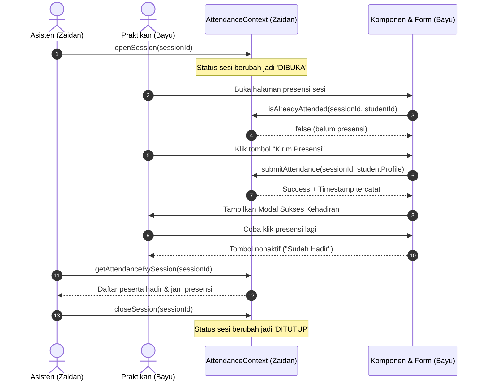

# Ringkasan Pembagian Tugas & PRD Sprint 1

**Proyek:** Aplikasi Presensi Kegiatan Praktikum Mandiri  
**Dokumen Pendukung:**
1. [Dokumen SRS Lengkap](file:///c:/Users/TaiBalap/Documents/GitHub/Praktikum_PPK_06/docs/SRS.md)
2. [Instruksi & PRD Teknis: Zaidan](file:///c:/Users/TaiBalap/Documents/GitHub/Praktikum_PPK_06/docs/TUGAS_ZAIDAN.md)
3. [Instruksi & PRD Teknis: Bayu](file:///c:/Users/TaiBalap/Documents/GitHub/Praktikum_PPK_06/docs/TUGAS_BAYU.md)

---

## 1. Pemisahan Modul & Tanggung Jawab

Tugas dibagi menjadi 2 peran yang independen agar dapat dikerjakan secara paralel oleh AI / Developer masing-masing tanpa konflik Git:

| Parameter | Zaidan | Bayu |
|---|---|---|
| **Area Fokus** | Core Architecture, State Management, Role Switching, Asisten Workflow | UI Component System, Navigation, Form Presensi, Praktikan Workflow |
| **Output File Utama** | `src/context/*`, `src/types/*`, `src/data/*`, `src/app/asisten/*` | `src/app/praktikan/*`, `src/components/common/*`, `src/components/praktikan/*` |
| **Logika Bisnis Utama** | Buka/Tutup Sesi, Rekapitulasi Hadir, Role Switcher | Validasi Anti-Double Attendance, Feedback Modal, Riwayat Mandiri |

---

## 2. Alur Integrasi Antar-Modul

---

## 3. Checklist Verifikasi Akhir Sprint 1

- [ ] Status sesi dapat diubah dari `BELUM_DIMULAI` $\rightarrow$ `DIBUKA` $\rightarrow$ `DITUTUP` oleh Asisten.
- [ ] Praktikan hanya dapat presensi saat sesi `DIBUKA`.
- [ ] Praktikan tidak dapat presensi dua kali pada sesi yang sama.
- [ ] Asisten dapat melihat rekap daftar hadir praktikan secara seketika.
- [ ] Praktikan dapat melihat riwayat kehadirannya sendiri.
- [ ] Terdapat tampilan *Empty State* ketika data jadwal atau rekap masih kosong.
- [ ] Seluruh layout responsif menggunakan Flexbox tanpa error TypeScript maupun linting.
